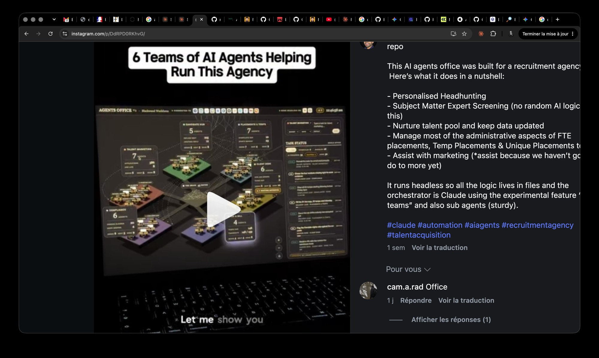
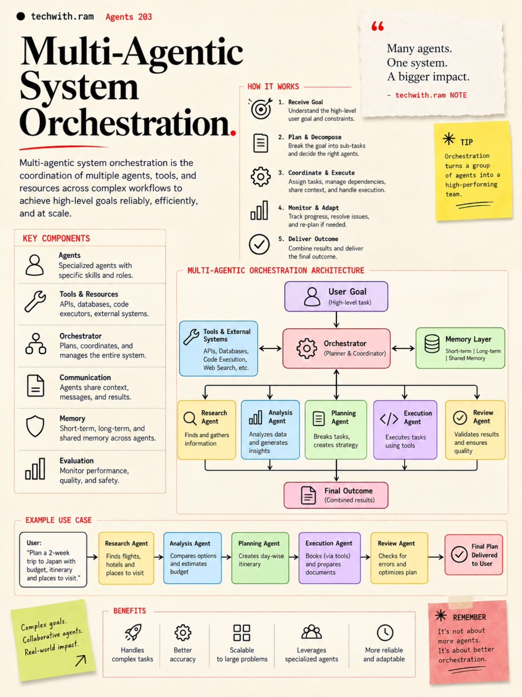
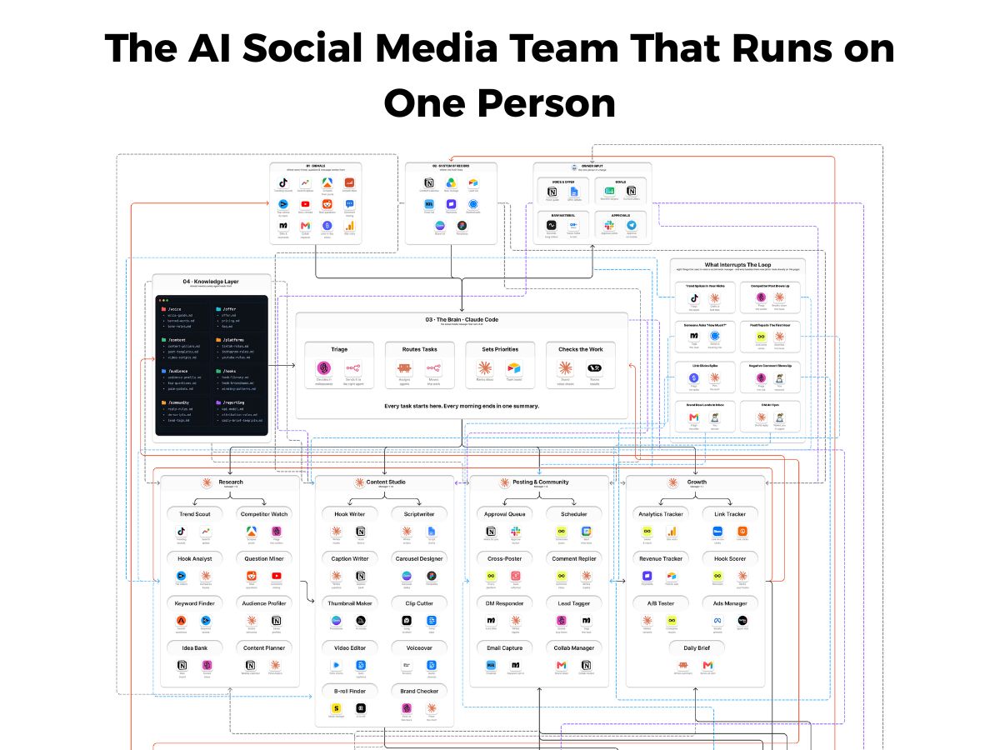
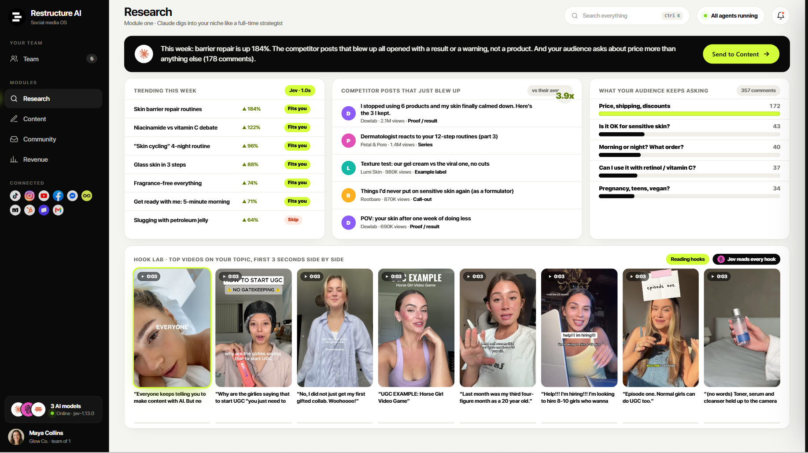
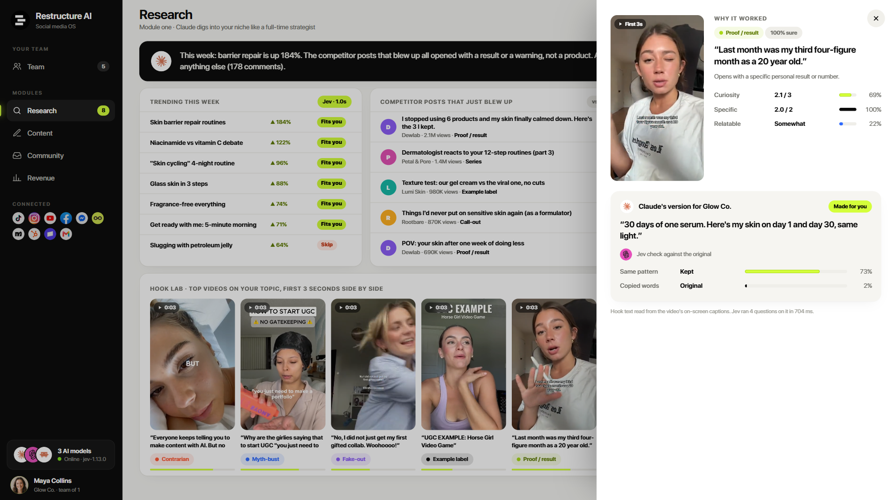
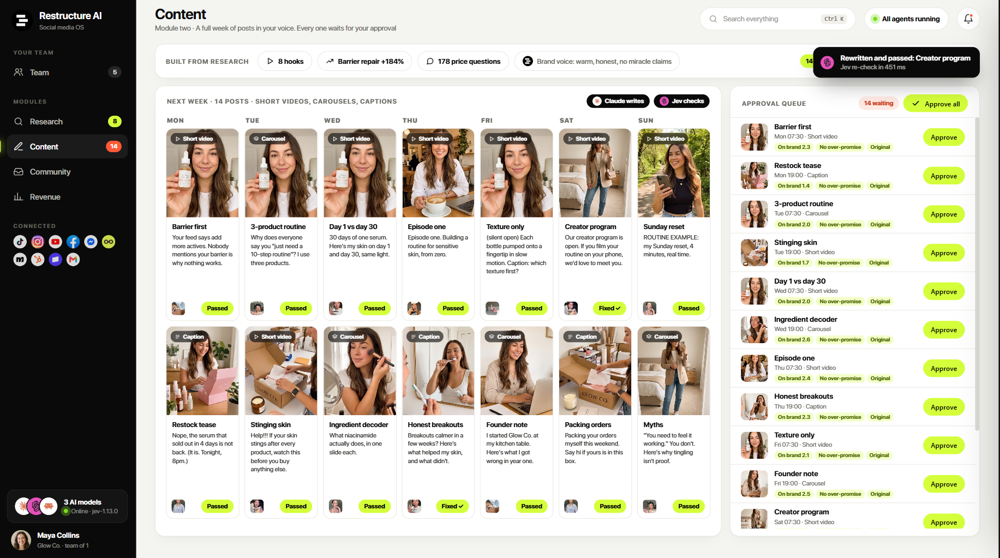
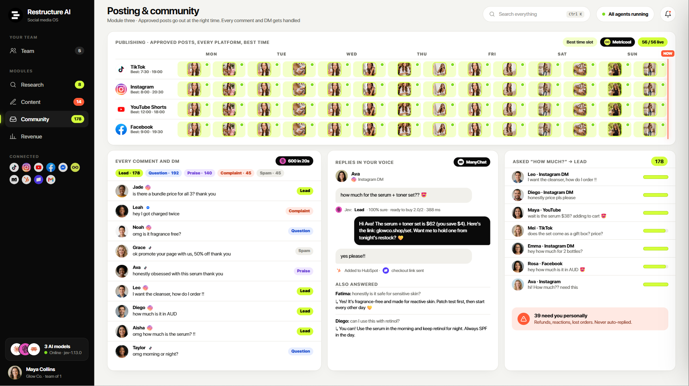
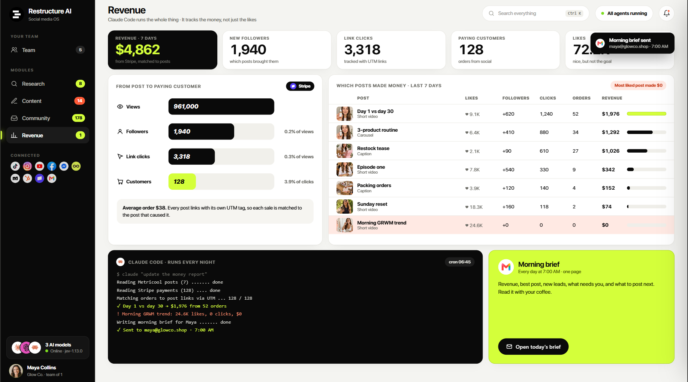
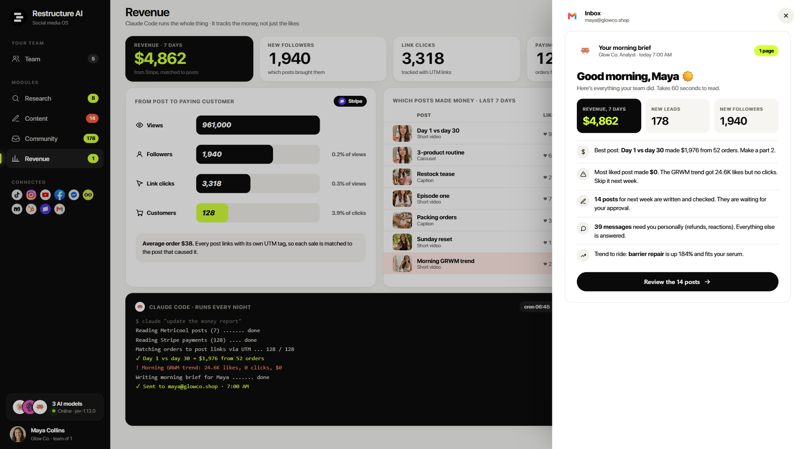
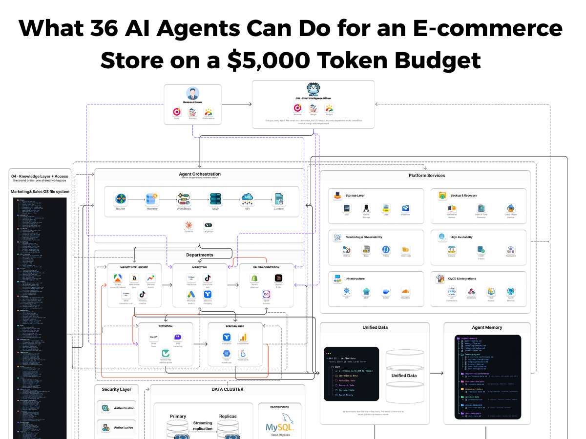

# HQ Office / Agency / Ecommerce — reference library (keep, do not discard)

Rad, 2026-09-25: "on garde bien les images et leur description dans le brain, les équipes sont
sûrement très bien constituées et le workflow aussi." Every reference below is kept as an image
next to this note, with the fullest transcription I could make (small text read on 3× crops).
`(≈)` = read at low resolution or inferred from an icon: check on the original before relying on it.
Critique and design principles live in `plan`; this note is the raw material.

---

## 1. "Agents Office" — isometric teams view (recruitment agency)

Source: Instagram post (instagram.com/p/DdRPD0RKhvG), "6 Teams of AI Agents Helping Run This
Agency". Built for a recruitment agency: personalised headhunting, subject-matter-expert screening
("no random AI logic"), talent pool nurturing, admin of FTE / temp / unique placements, marketing
assist. "It runs headless so all the logic lives in files and the orchestrator is Claude using the
experimental feature 'agent teams' and also sub agents."

UI (top bar): "AGENTS OFFICE v3 · Blackwood Workforce (≈)", a row of ~13 connector icons, a clock.
Centre: "THE BRAIN · ROUTER" hub, dotted links to every platform.
Teams (one coloured isometric platform each, card = agent count + 2 metrics + active/wait/done):

| Team | Agents | Colour |
|---|---|---|
| Candidate Hub | 5 | green |
| Placements & Temps | 7 | teal |
| Talent Marketing | 7 | red |
| Client Desk | 6 (badge "waiting approval") | yellow |
| Compliance | 6 | purple |
| Pay & Bill (≈) | 4 | blue |

Right panel: task input (team selector "Talent Marketing ▾", "type a task for talent marketing…",
two dropdowns, send) · "TASK STATUS" with filters (all / scheduled / in progress / waiting / done ≈)
and task cards (status pill, team, time, progress bar). Zoom controls bottom right.

Why it matters: the teams map a whole business line (sourcing → placement → client → compliance →
billing → marketing), each with a small headcount; approvals are visible on the team card.

---

## 2. "Multi-Agentic System Orchestration" (techwith.ram, generic model)

Loop: 1 Receive goal → 2 Plan & decompose → 3 Coordinate & execute → 4 Monitor & adapt → 5 Deliver.
Components: Agents · Tools & resources · Orchestrator · Communication · Memory (short / long /
shared) · Evaluation. Architecture: User goal → Orchestrator (planner & coordinator) ↔ Tools &
external systems, ↔ Memory layer → Research, Analysis, Planning, Execution, Review agents → Final
outcome. Example: "Plan a 2-week trip to Japan" through the 5 agents. Punchline: "It's not about
more agents. It's about better orchestration." Mapping to HQ and critique: `plan`.

---

## 3. "The AI Social Media Team That Runs on One Person" (diagram + article)

 (image cut at the bottom in the version shared)

**01 · Signals** — "where every trend, question & message comes from": TikTok trending sounds ·
Google Trends search spikes · Apify (≈) scrapes rival posts · growth data (≈) · top videos by topic
(≈) · YouTube rival shorts · Reddit real questions · comment mining · ManyChat DMs & keywords ·
Gmail collab requests · Stripe (≈) link-in-bio clicks · Google Analytics site visits.

**02 · System of Record** — "where the truth lives": Notion content calendar · Google Drive raw
footage · Airtable lead list · Kit (≈) email list · payments (≈ Stripe/Lemon) · Calendly bookings ·
Canva brand kit · Figma templates.

**Owner Input** — "the one person in charge": Voice & offer (Notion voice guide, Google Docs offer
details) · Goals (Sheets monthly targets ≈) · Raw material (long videos ≈ Descript, voice notes ≈
Otter) · Approvals (Slack approve posts, mobile ≈ Telegram).

**03 · The Brain — Claude Code**: Triage (decides in milliseconds ≈) · Routes tasks · Sets
priorities · Checks the work. "Every task starts here. Every morning ends in one summary."

**04 · Knowledge Layer** — "shared memory every agent reads from":
- `/voice`: voice-guide.md, banned-words.md, tone-rules.md
- `/offer`: offer.md, pricing.md, faq.md
- `/content`: content-pillars.md, post-templates.md, video-scripts.md
- `/platforms`: tiktok-rules.md, instagram-rules.md, youtube-rules.md
- `/audience`: audience-profile.md, top-questions.md, pain-points.md
- `/hooks`: hook-library.md, hook-breakdowns.md, winning-patterns.md
- `/community`: reply-rules.md, dm-scripts.md, lead-tags.md
- `/reporting`: kpi-model.md, attribution-rules.md, daily-brief-template.md

**Teams (33 agents)**
- Research: Trend Scout · Competitor Watch · Hook Analyst · Question Miner · Keyword Finder ·
  Audience Profiler · Idea Bank · Content Planner
- Content Studio: Hook Writer · Scriptwriter · Caption Writer · Carousel Designer · Thumbnail
  Maker · Clip Cutter · Video Editor · Voiceover · B-roll Finder · Brand Checker
- Posting & Community: Approval Queue · Scheduler · Cross-Poster · Comment Replier · DM Responder ·
  Lead Tagger · Email Capture · Collab Manager
- Growth: Analytics Tracker · Link Tracker · Revenue Tracker · Hook Scorer · A/B Tester · Ads
  Manager · Daily Brief

**What Interrupts The Loop** — "eight things that used to need a social media manager, and who
handles them now":

| Event | First responder | Then |
|---|---|---|
| Trend spikes in your niche | TikTok flags the spike | Claude drafts a hook test (≈) |
| Competitor post blows up | scraper flags the outlier | Claude breaks down the hook |
| Someone asks "How much?" | ManyChat tags the lead | booking link sent (≈ Calendly) |
| Post flops in the first hour | Metricool: low early views | Claude rewrites the hook |
| Link clicks spike | Stripe flags the spike | Claude pins the post |
| Negative comment blows up | flags the risk | **You respond** |
| Brand deal lands in inbox | Gmail flags the offer | **You decide** |
| DM at 11 pm | Claude drafts a reply | **wakes you if urgent** |

**Article text (French version pasted by Rad), in substance**: one-person company, full social team
run by AI — research, content, publishing, reporting — "but nothing goes public without the owner's
approval: the system does the work, the human keeps the last word".
- Module 1 Research: trends of the week, competitor posts that went viral, most-asked questions in
  comments; top videos compared on their first 3 seconds and why they worked → a structured file
  that feeds Content.
- Module 2 Content: a full week (short videos, carousels, captions) in brand voice; each video opens
  on a hook inspired by what already works, written for the brand, not copied; every post waits in
  an approval queue.
- Module 3 Publishing & community: approved posts go out on every platform at the best time;
  comments and DMs answered in brand voice; intent detection turns every price question into a lead.
- Orchestration (Claude Code): tracks transactions, not likes (post → follower → click → purchase);
  one-page brief every morning; "routes tasks and enforces rules, but never publishes on its own".
- Why it matters: automate research, writing, publishing and reporting; submit every public post to
  human validation; measure real outcomes, not vanity metrics.

---

## 4. "Restructure AI — Social media OS" (product demo screens, fictional brand Glow Co.)

  
  

Shell: left sidebar — Team (5) · Modules: Research (8), Content (14), Community (178), Revenue (1)
(badges = items needing the owner) · Connected: TikTok, Instagram, YouTube, Facebook, Messenger,
Metricool, ManyChat, HubSpot, Stripe, Gmail · "3 AI models · Online · jev-1.13.0" (Claude writes,
"Jev" checks, + one more) · user "Maya Collins, Glow Co., team of 1". Top: search (Ctrl K), "All
agents running", notifications.

- **Research** ("Claude digs into your niche like a full-time strategist"): insight banner ("barrier
  repair is up 184 %; competitor posts that blew up all opened with a result or a warning, not a
  product; your audience asks about price more than anything else (178 comments)") + "Send to
  Content". Panels: Trending this week (topic, growth %, Fits you / Skip) · Competitor posts that
  just blew up (views, hook type: Proof/result, Series, Example label, Call-out; "vs their avg 3.9×")
  · What your audience keeps asking (price/shipping 172, sensitive skin 43, order 40…) · Hook Lab:
  top videos' first 3 s side by side, each tagged (Contrarian, Myth-bust, Fake-out, Example label,
  Proof/result). Drawer "Why it worked": hook quote, type + certainty, scores (Curiosity 2.1/3,
  Specific 2.0/2, Relatable "somewhat"), "Claude's version for Glow Co." + "Jev check against the
  original: same pattern kept 73 %, copied words 2 % (original)"; "hook text read from the video's
  on-screen captions".
- **Content** ("a full week of posts in your voice, every one waits for your approval"): "Built from
  research" chips (8 hooks, trend, 178 price questions, brand voice "warm, honest, no miracle
  claims"); week grid Mon-Sun, 14 posts (short video / carousel / caption) each with Passed or
  Fixed; "Claude writes · Jev checks"; toast "Rewritten and passed: Creator program, Jev re-check in
  451 ms"; Approval queue (14 waiting): slot, format, checks On brand x.x · No over-promise ·
  Original, Approve per item + "Approve all".
- **Posting & community**: publishing grid per platform with best time slots (TikTok 7:30-19:00,
  Instagram 8:00-20:30, YouTube Shorts 12:00-18:00, Facebook 9:00-19:30), "Metricool", 56/56 live ·
  Every comment and DM, classified Lead 178 / Question 192 / Praise 140 / Complaint 45 / Spam 45
  ("600 in 20 s") · Replies in your voice (ManyChat): price answer + checkout link, "Added to
  HubSpot · checkout link sent", "Also answered" FAQ · Asked "How much?" → Lead list (178) ·
  **"39 need you personally — refunds, reactions, lost orders. Never auto-replied."**
- **Revenue** ("Claude Code runs the whole thing · it tracks the money, not just the likes"): KPIs
  revenue 7 days (from Stripe, matched to posts), new followers, link clicks (UTM), paying
  customers, likes ("nice, but not the goal") · funnel views → followers → clicks → customers with
  rates · "Which posts made money" table (likes, followers, clicks, orders, revenue; "most liked post
  made $0") · "Claude Code · runs every night" terminal (cron 06:45: read Metricool posts, read Stripe
  payments, match orders to post links via UTM, flag the $0 trend, write and send the brief) ·
  Morning brief card (7:00, one page).
- **Morning brief** (email): revenue, new leads, new followers; best post + "make a part 2"; most
  liked post made $0 → skip next week; 14 posts waiting for approval; 39 messages need you; trend to
  ride; button "Review the 14 posts".

---

## 5. "What 36 AI Agents Can Do for an E-commerce Store on a $5,000 Token Budget"

 (image cut at the bottom in the version shared)

- **Business Owner**: Goals · Strategy · Performance → **CIO — Chief Intelligence Officer** agent:
  Revenue · Margin · Budget. "One goal, every agent. The owner sets the number, the CIO holds it, and
  every department works toward that revenue, margin and budget target."
- **Agent Orchestration** ("how the 36 agents route, remember and run"): Router → Memory →
  Workflows → MCP → API → Context; engines Claude AI + LangGraph.
- **Departments** (arrows: Market Intelligence → Marketing → Sales & Conversion; all → Retention →
  Performance, with feedback loops):
  - Market Intelligence: scrape competitor stores (Apify ≈) · mine review gaps (Amazon) · demand
    trends (Google Trends) · what competitors run (Meta Ads library) · trending creative (TikTok)
  - Marketing: paid social (Meta Ads) · short-form ads (TikTok) · hourly ad metrics (Google Ads) ·
    search & shopping (≈ Triple Whale/Yotpo icon)
  - Sales & Conversion: store & checkout (Shopify) · support & FAQ (≈ Gorgias) · upsell bundles
  - Retention: email flows (Klaviyo) · SMS marketing (≈ Postscript/Attentive) · reviews the ads can
    quote (≈ Okendo/Judge.me)
  - Performance: attribution (≈ Triple Whale) · site behaviour (Google Analytics) · data warehouse
    (BigQuery) · dashboards (Looker Studio)
- **04 · Knowledge Layer + Access** — "the brand brain · one shared workspace", "Marketing & Sales OS
  file system": ~18 folders of .md files (unreadable at this resolution: ask Rad for the original).
- **Unified Data** — "every piece of data lands here": 5 streams in ($5,000 AI tokens): operational,
  marketing, research, customer data, agent memory. "All five streams flow into one unified store.
  The whole system runs on about $5,000 in AI tokens a month."
- **Agent Memory**: `/agent-memory` (agent-memory.md, memory-flow.md, learning-process.md,
  retention-rules.md, context-sync.md) · `/memory-types` (historical-performance, customer-insights,
  campaign-history, product-data, agent-decisions, business-goals) · one folder per type with its
  data file (performance-data.md: past results, what worked, what didn't ≈; insights-data.md:
  preferences, behaviour, feedback; campaigns-data.md: past campaigns, creatives, performance;
  product-data.md: inventory, features, pricing, updates; decisions-data.md: actions, reasoning,
  outcomes; goals-data.md: revenue targets, growth, key metrics).
- **Platform Services**: Storage (SSD, object storage, logs, snapshots) · Backup & recovery
  (automated backup, point-in-time recovery, cross-region backup) · Monitoring & observability
  (metrics, logs, traces, **token cost**) · High availability (failover, health checks, replication)
  · Infrastructure (API, MCP, Docker, Cloudflare) · CI/CD & integrations (API connectors, webhooks,
  tool access, agent services).
- **Security layer**: authentication, authorization (rest cut). **Data cluster**: primary →
  streaming replication → replicas; MySQL read replicas.

Why it matters: a CIO agent that owns the business numbers (revenue, margin, token budget) above
the departments; memory typed by kind (performance, customers, campaigns, products, decisions,
goals) and decisions logged with their reasoning and outcome — close to HQ's brain.

---

## What these references agree on (useful for HQ Office design)

1. One brain/orchestrator in Claude Code that triages, routes, prioritises and **checks**.
2. A file-based knowledge layer every agent reads (voice, offer, audience, rules, templates).
3. Teams of 4-10 specialised roles per business function; handoff between teams through files.
4. Escalation list explicit: what interrupts the loop, and which cases always go to the human.
5. A morning one-page brief; results measured in money, not vanity metrics.
6. Producer / checker pairs, with the checker a different model.
