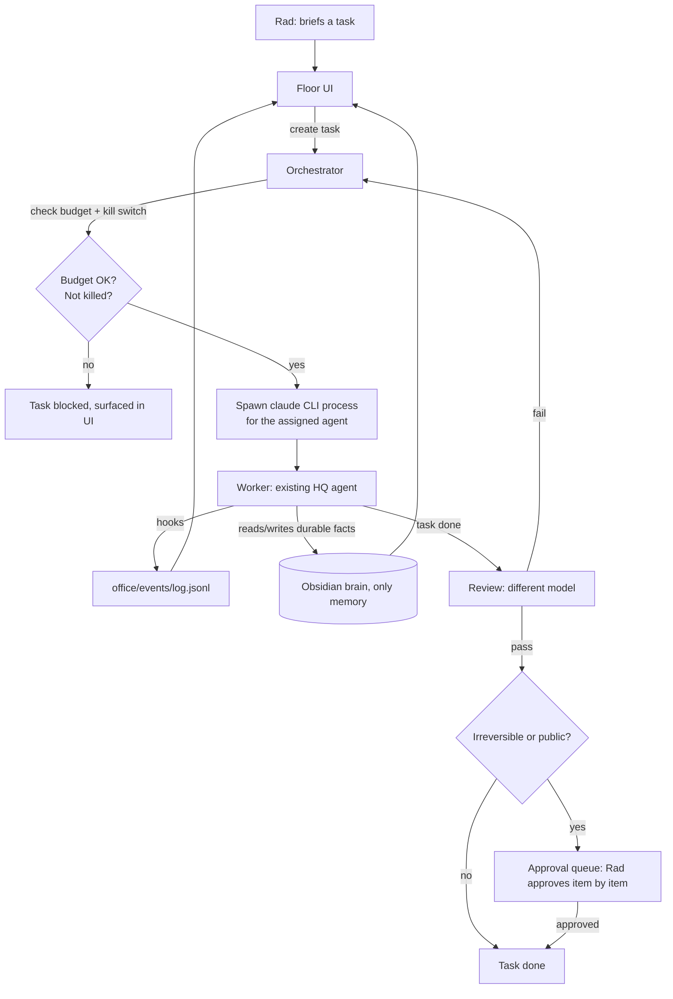

# HQ Office: architecture proposal

Grounded in `docs/context/plan.md`'s design principles and the reusable
pieces identified in `prior-art.md` and `agent-teams.md`. No code in this
phase; this is the shape phase 1/2 would build (see `mvp.md` for the cut).

## Components

### Floor UI
A read-only view (phase 1), then a task-input surface (phase 2), of every
project as an isometric platform (one floor per entry in the floors
registry, see § Mapping below), matching
`img/ref-design-isometric-teams.jpg`: one platform per floor, a badge for
agents *currently* active there (not a fixed roster, see § Mapping), a
live/idle/waiting badge, an approval count badge. Dormant floors (no recent
activity) render as a collapsed strip rather than full platforms so 26
project directories don't mean 26 empty platforms. A right panel lists tasks
with status (pending, in progress, waiting on approval, done), filterable,
mirroring the "Restructure AI" demo's sidebar badges (`references.md`
section 4). Renders client-side; reads state, never writes it directly (all
writes go through the orchestrator or the human approving in the queue).

### Orchestrator
The single persistent dispatcher: one, not one per floor. Per `plan.md`'s
own gap analysis, this must be a session or a script, never a subagent (a
subagent cannot outlive the call that spawned it; HQ's actual choice is that
multi-step chains are driven by a session or a script so each step is
audited, not, as an earlier draft of this doc said, because subagents
can't nest: they can, up to a default depth of 3). Concretely: a
long-running `claude -p` loop (or a small Node/Python daemon that calls
`claude -p` per task) that reads the task queue, picks the next task,
resolves which floor (project) and which existing HQ agent should run it
(from the ~430-agent registry, not a new agent per task), and dispatches by
spawning that agent as its own `claude` process with the floor's project
directory as its cwd, matching munder-difflin's "one agent, one real CLI
process" model rather than the-office's in-process SDK calls, specifically
so the project's own CLAUDE.md, hooks, skills, and model routing apply
automatically.

A "floor boss" is a role of this same orchestrator, filtered on
`project == <floor>`, never a second LLM process (see
`floor-per-project-revision.md` § 2 for why: a per-floor LLM boss would
chain 2-3 routing-only sessions per task and become a second, ungated
creator of tasks, breaking the `parallel_group` fan-out gate below). Default
concurrency is **one task in progress per floor**; more only through an
explicit `parallel_group`, exactly like fan-out across floors.

### Workers
Each worker is an existing HQ agent (from the registry, `scripts/find.py`),
run as its own `claude` CLI process (a background session via `claude --bg`,
or a plain `claude -p` invocation for a one-shot task). Not a persistent Sims
character with its own memory; the "character" on the floor is a rendering of
that process's current state, sourced from Claude Code hooks (see event log
below).

### Task files and mailboxes
Borrowed directly from munder-difflin's `HIVE.md` pattern, adapted to drop
its two conflicts (auto-commit, second memory store). One JSON file per task
under a project-local (not brain) working directory, written via
temp-file-then-rename for atomicity:

```
office/
  tasks/<task-id>.json        # the task file (see contract below)
  events/log.jsonl            # append-only event log (see contract below)
  inboxes/<agent-name>.json   # optional, only if a task needs agent-to-agent
                               # handoff; most tasks need none
```

No `outbox/`, no per-agent `memory.md`. Handoff between agents happens by one
agent finishing a task and the orchestrator creating the next task in the
chain, reading the brain for anything that needs to persist. This is
deliberately thinner than munder-difflin's Hive: HQ does not need a
blackboard or a FIPA-style message schema for a single-orchestrator, mostly
one-agent-at-a-time system. Add mailboxes back only if phase 3 needs genuine
peer-to-peer coordination between two long-running agents.

### Approval queue
A subset of tasks, gated on `requires_approval: true` (see contract), shown
in the floor UI's right panel exactly like the "Restructure AI" reference's
per-item approval list: one Approve action per item, no "approve all" for
anything that leaves HQ or touches money, git `main`, or a mainnet action
(the explicit anti-pattern flagged in `references.md`). Internal, reversible
items (a brain note draft, a local file edit) can batch-approve; public or
irreversible ones cannot, enforced by a field on the task, not by UI
convention alone.

### Budget and kill switch
Per project (floor), read from the existing `.claude/logs/usage.tsv` ledger
plus a per-floor cap in the floors registry (`office/floors.json`, `cap_usd`)
that the orchestrator checks before dispatching: if a floor's spend this
period exceeds its cap, the orchestrator refuses new tasks for that floor and
surfaces it in the UI, rather than the agent self-policing its own budget.
**A global cap comes first, per-floor caps second**: the binding limit is
Rad's subscription, shared by every floor; 20 respected floor caps can still
exhaust the plan. `usage.tsv` needs one ledger change to make this
computable at all: it has no team/project column today, so add a `project`
column (writers: `scripts/career-morning.sh`, `scripts/agency-triggers.py`,
`scripts/auto_handoff.py`; reader: `scripts/usage-report.py`; backfill old
rows from a fixed automation→project map); this touches HQ scripts outside
this repo, so it needs Rad's go (given 2026-09-28: approved). The kill
switch is a flag file per floor (`office/kill/<project>.flag`), plus
`office/kill/_all.flag` for the global orchestrator; its presence makes the
orchestrator refuse to dispatch to that floor (or to any floor, for `_all`)
until removed. Both are enforced in the orchestrator's dispatch loop, so a
compromised or buggy agent cannot bypass its own budget or revive itself
past a kill switch. Services (§ Mapping) never get their own cap or kill
switch: the blast radius that justifies one is the project (its repo, git
history, keys), not a slice of it; spend per service is a `GROUP BY` on the
ledger, not a gate.

### Event log
Append-only JSONL, one line per Claude Code hook firing
(`UserPromptSubmit`, `PreToolUse`, `PostToolUse`, `Notification`, `Stop`,
`SubagentStop`), the same event plane munder-difflin uses, with pixel-agents'
lesson applied from day one: hooks alone are not reliable enough to be the
only signal ("hook-based IPC failed... JSONL watching works" per
`~/HQ/PROJECTS/pixel-agents/CLAUDE.md:194`), so the floor UI's status also
polls each agent's own Claude Code JSONL transcript as a fallback, not as an
afterthought bolted on after hooks turn out to be flaky in practice.

### Brain as the only memory
No new memory store, no MemPalace-equivalent, no per-agent `memory.md`. Any
fact a task produces that should outlive the task goes to
`KNOWLEDGE_BASE/` through the existing note types (observation, decision,
hypothesis) via the existing `brain.sh` tooling, written by the agent that
did the work, exactly as it already does outside HQ Office. Task files
themselves are ephemeral (cleaned up once the task is done and anything worth
keeping is in the brain); they are working state, not memory.

## Data contracts

### Task file (`office/tasks/<task-id>.json`)

```json
{
  "id": "2026-09-28T10-15-00Z-a1b2",
  "project": "taf-harness",
  "service": null,
  "agent": "tracking-audit",
  "model": "sonnet",
  "brief": "Audit the sGTM container on client X for consent propagation gaps",
  "requires_approval": true,
  "irreversible": false,
  "parallel_group": null,
  "status": "pending",
  "dependencies": [],
  "budget_usd_cap": 2.0,
  "created_at": "2026-09-28T10:15:00Z",
  "result_ref": null
}
```

`project` is the floor id (from `office/floors.json`) and sets the worker's
cwd; `"project": "hq"` means the HQ root itself (brain, automations,
registry work that belongs to no project directory). A single `project`
field, not a separate `team`: two fields that must agree would drift.
`service` is optional, a grouping key declared under that floor in the
registry (UI zone + queue filter + 0-token routing hint); it never gets its
own process, budget, kill switch or concurrency lane (see § Budget). A task
has exactly one floor; multi-floor tasks are out of scope through phase 2.
`parallel_group` is what opts a task into fan-out (§ Enforcing, point 1);
`null` by default. `status` moves through `pending`, `in_progress`,
`waiting_approval`, `done`, `failed`, `killed`. `irreversible` is what routes
a task to the approval queue as non-batchable, regardless of
`requires_approval`, matching design principle 3 exactly ("human before push
to main, send, pay, publish, mainnet"). `result_ref` points at a brain note
path once the agent writes one, not at task-local storage.

### Event (`office/events/log.jsonl`, one JSON object per line)

```json
{"ts":"2026-09-26T10:15:03Z","task_id":"2026-09-26T10-15-00Z-a1b2","agent":"tracking-audit","hook":"PreToolUse","tool":"Read","detail":"docs/gtm/container.json"}
```

Consumers (the floor UI) track their own read cursor into the file; the log
itself is never rewritten, only appended, so two readers never conflict and
a crash never loses history mid-write.

## Process model: local web app, not Electron

Recommendation: a local web app (a small server the orchestrator process
also runs, opened in a browser tab on localhost, LAN-reachable later for
phone access), not Electron. Reasons:

1. `plan.md` already states this preference explicitly ("local web app...
   rather than Electron"), and nothing in the prior-art review overturns it.
2. Both Electron prior-art repos (munder-difflin, the-office) carry real
   packaging costs that don't buy HQ anything it needs. Electron-specific
   files (`electron-builder.yml`, code signing, auto-update, per-OS installers
   per `the-office/README.md`) are entirely about shipping a desktop app to
   third parties. HQ Office has exactly one user; a browser tab has zero
   packaging cost and updates by refreshing.
3. `node-pty` (used by munder-difflin for real terminal panes) works the same
   from a Node backend serving a browser tab as it does from an Electron main
   process. Nothing about the "real CLI process" requirement needs Electron
   specifically; xterm.js in a browser tab, fed by the same backend over a
   WebSocket, gives the identical terminal experience.
4. Electron's main advantage over a local web app, native OS integration
   (menu bar, notifications, file dialogs), is not something `plan.md` asks
   for; alerts already go through `say` and PushNotification, both callable
   from a plain Node/Python backend with no Electron dependency.

## Mapping: floors registry, not a hand-picked domain table

Revised 2026-09-28 (`floor-per-project-revision.md`): a floor is an existing
`PROJECTS/<name>/` directory, not a hand-picked business domain. Reason: a
worker is a `claude` process, and the project directory is its cwd, so the
project's own `CLAUDE.md`, skills and brain folder (`KNOWLEDGE_BASE/projects/
<p>/`) apply by construction. A domain like "Quant" or "Research" has no
brain folder of its own and would need a mapping the brain doesn't know.

`office/floors.json` is the registry: central to this repo, generated by a
deterministic script (`ls PROJECTS/` + `confidential-projects.sh` + a small
override file), never hand-maintained, never a file dropped into each
project (`taf-harness` stays self-contained, `Megakichta` stays read-only).
Per floor: `id` (lowercase; directory casing varies, e.g. `PROJECTS/Kyro`
vs `KNOWLEDGE_BASE/projects/kyro`), `dir`, `mode` (`active` | `read_only` |
`excluded`), `cap_usd`, optional `domain` (a pure grouping tag for the UI,
e.g. "Quant" spanning `rad-lab` + `wolfdogz`; no boss, no budget of its own,
same rule as `service`, one level up). `excluded` covers the confidential
project: no floor, no task, no event, no usage line; the event writer also
drops any event whose cwd or touched path falls under an excluded project.

This is a read map for phase 1 (which floors and agents exist, what each is
doing right now: the badge counts agents *currently active* there, not a
fixed roster: of 26 project directories, only one has its own dedicated
agents today), and a dispatch map for phase 2 (which floor a new task
belongs to, known deterministically once Rad briefs from a given floor in
the UI). No floor is invented that doesn't already exist as a project.

## Enforcing the four design principles in code

Each principle becomes a specific mechanism in the orchestrator's dispatch
loop, not a line in a prompt an agent could ignore under pressure:

1. **One agent by default.** The orchestrator's task-creation step defaults
   to a single task with a single assigned agent. Fan-out (multiple tasks
   with the same `dependencies: []` parent) requires an explicit
   `parallel_group` field set by whoever created the task, so parallel work
   is an opt-in the orchestrator can log and budget for, not something an
   agent can trigger by simply calling the Agent tool more than once.
2. **Review by a different model.** A task's `status` cannot move directly
   from `in_progress` to `done`. It must pass through a `review_pending`
   state, and the review step's `model` field must differ from the
   producing task's `model` field; the orchestrator rejects a review task
   where both models match, so the check runs in code, not by convention.
3. **Human before the irreversible.** Enforced by the `irreversible` field
   on the task contract: the orchestrator refuses to mark such a task `done`
   without a corresponding approval record in the queue's own log, and the
   floor UI cannot batch-approve anything with that flag set. The kill
   switch and per-team budget cap (above) are the same kind of gate, checked
   before dispatch, not after the fact.
4. **One memory.** No task file, event log entry, or UI state is a place an
   agent is allowed to write durable facts. The orchestrator's own agent
   template (the boilerplate every dispatched task gets) tells the agent
   explicitly to write findings worth keeping to the brain, and nowhere
   else; there is simply no second memory store for it to write to instead.

## Diagram


